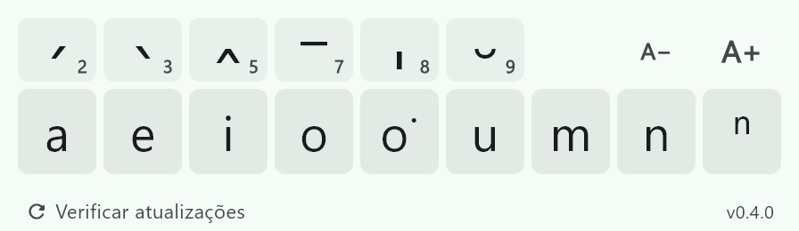
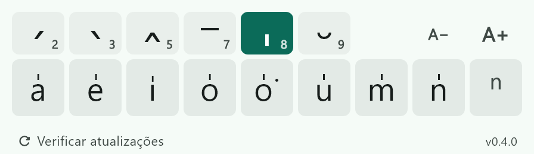

  

<h1 align="center">Teclado Taiwanês</h1>

  Um teclado na tela para escrever taiwanês em <b>Pe̍h-ōe-jī</b> (POJ) 
  em qualquer programa, no Windows e no Mac.

  <a href="https://github.com/chiangctech3d/taiwanese_keyboard/releases/latest"><b>⬇ Baixar a última versão</b></a>

  

---

## Para que serve

Escrever **Tâi-oân-ōe** exige letras que o teclado comum não tem:
**á à â ā a̍ ă**, o **o͘**, o **ⁿ**…

O Teclado Taiwanês é uma janelinha que fica por cima das outras. Você
clica no acento, depois na letra, e o caractere aparece **direto onde você
está escrevendo**: Word, navegador, WhatsApp Web, bloco de notas, o que
for. Não precisa copiar e colar, e o cursor continua no seu texto.

## Como usar

  

1. **Clique no acento** (linha de cima). Os números são os tons do POJ.
2. **Clique na letra** (linha de baixo). Ela já mostra como vai ficar.
3. Pronto: o caractere aparece no seu texto, e o acento é desmarcado.

| Tom | Acento | Exemplo |
|:---:|:---:|:---|
| 1 e 4 | sem acento | a, ah |
| 2 | ´ | á |
| 3 | ` | à |
| 5 | ^ | â |
| 7 | ¯ | ā |
| 8 | ˈ | a̍ |
| 9 | ˘ | ă |

**Dicas**

- **Letra sem acento:** clique só na letra (útil para o **o͘**).
- **Mudou de ideia?** Clique de novo no acento para desmarcar.
- **Maiúsculas:** segure o **Shift** do seu teclado (ou ligue o Caps Lock).
- **ⁿ** (nasal) nunca leva acento.
- **A− / A+** diminuem ou aumentam o teclado. O tamanho fica salvo.
- **Verificar atualizações**, no rodapé, avisa quando sai uma versão nova.

## Instalar

Baixe na página [**Releases**](https://github.com/chiangctech3d/taiwanese_keyboard/releases/latest).

### Windows

1. Baixe `teclado-taiwanes-windows.zip` e descompacte.
2. Abra `teclado_taiwanes.exe`. Deixe os outros arquivos na mesma pasta.
3. Se aparecer *"O Windows protegeu o computador"*, clique em
   **Mais informações → Executar assim mesmo**. O aviso aparece porque o
   app ainda é novo e pouca gente baixou.

> Programas abertos **como administrador** não aceitam a digitação de
> outros programas. Neles o teclado não funciona.

### Mac

1. Baixe `teclado-taiwanes-macos.dmg`, abra e arraste o app para
   **Aplicativos**.
2. Na primeira vez o Mac bloqueia a abertura. Tente abrir, depois vá em
   **Ajustes do Sistema → Privacidade e Segurança** e clique em
   **Abrir Mesmo Assim**.
3. Permita o app em **Ajustes do Sistema → Privacidade e Segurança →
   Acessibilidade**. É isso que deixa ele digitar nos outros programas.
   Sem essa permissão, o caractere é copiado e você cola com ⌘V.

> Depois de atualizar, se o teclado parar de digitar, remova o app da
> lista de Acessibilidade (botão **−**) e adicione de novo.

## Privacidade

O app **não coleta nem envia nenhum dado seu**. Ele só digita os caracteres
em que você clica.

A única conexão com a internet é para ver se há versão nova: ao abrir e ao
clicar em **Verificar atualizações**, ele pergunta ao GitHub
(`api.github.com`) qual é a última versão publicada.

## Encontrou um problema? Tem uma ideia?

Abra uma [**issue**](https://github.com/chiangctech3d/taiwanese_keyboard/issues)
contando o que aconteceu, em qual sistema (Windows ou Mac) e em qual
programa você estava escrevendo. Sugestões também são bem-vindas.

Quer mexer no código? Veja o [guia técnico](docs/DESENVOLVIMENTO.md).

## Licença

Software livre, sob a licença [GPL-3.0](LICENSE).

## Code signing policy

Free code signing provided by [SignPath.io](https://about.signpath.io),
certificate by [SignPath Foundation](https://signpath.org).

- Autor, revisor e aprovador: [chiangctech3d](https://github.com/chiangctech3d)
- Só o executável `teclado_taiwanes.exe`, compilado a partir deste
  repositório pelo GitHub Actions, é assinado.
